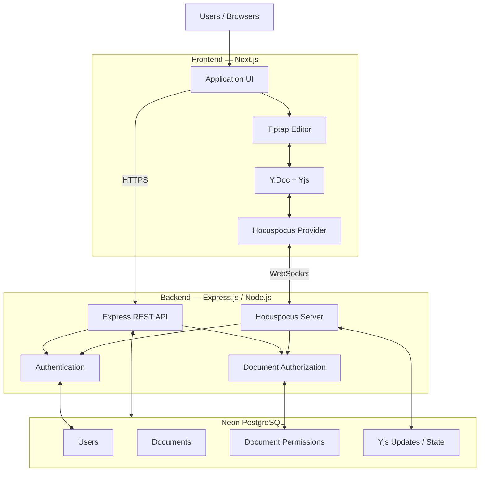
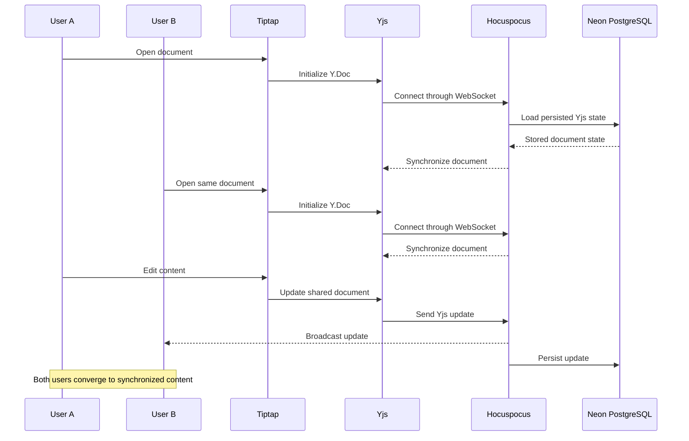
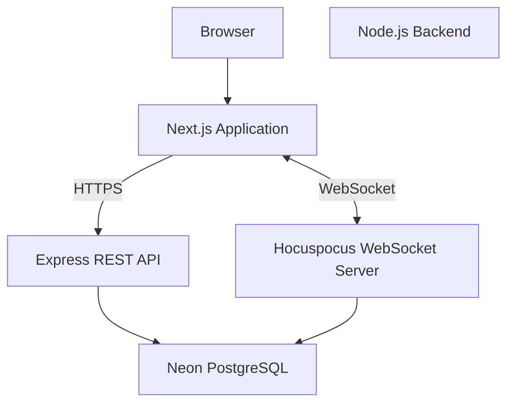

# ARCHITECTURE.md

# CollabNote — Technical Architecture

**Version:** 1.0  
**Status:** Initial architecture proposal  
**Architecture style:** Monorepo with separate frontend and backend applications

---

## 1. Architecture Overview

CollabNote is a real-time collaborative text editor built using a modular web architecture.

The system consists of:

- Next.js frontend application.
- Express.js backend API.
- Hocuspocus collaboration server.
- Tiptap rich-text editor.
- Yjs CRDT synchronization engine.
- Neon PostgreSQL database.
- WebSocket communication.

The frontend communicates with the backend through HTTPS REST APIs for normal application operations and WebSockets for collaborative document synchronization.

### 1.1 High-Level Architecture



---

## 2. Technology Responsibilities

Each technology must have a clearly defined responsibility.

| Technology | Responsibility |
|---|---|
| Next.js | Frontend application and routing |
| Tailwind CSS | Styling and responsive layouts |
| Shadcn UI | Reusable interface components |
| Tiptap | Rich-text editing interface |
| Yjs | Shared document state and CRDT merging |
| Hocuspocus | Collaboration sessions and synchronization |
| WebSockets | Real-time communication transport |
| Express.js | REST APIs and application business logic |
| Neon PostgreSQL | Persistent application and document data |
| Node.js | Backend runtime |
| TypeScript | Type safety across applications |

### Important architectural distinction

- WebSockets do not resolve editing conflicts.
- Yjs provides the collaborative data model.
- Hocuspocus manages the server-side collaboration workflow.
- Awareness carries temporary presence and cursor information.
- PostgreSQL provides durable storage.
- Authorization determines whether a user can access a document.

Do not combine these responsibilities into one component.

---

## 3. Monorepo Structure

Use npm workspaces to manage the project.

```text
collaborative-editor/
│
├── apps/
│   ├── web/
│   │   ├── app/
│   │   ├── components/
│   │   ├── hooks/
│   │   ├── lib/
│   │   ├── services/
│   │   ├── types/
│   │   └── package.json
│   │
│   └── server/
│       ├── src/
│       │   ├── api/
│       │   ├── auth/
│       │   ├── collaboration/
│       │   ├── database/
│       │   ├── middleware/
│       │   ├── services/
│       │   ├── config/
│       │   └── index.ts
│       └── package.json
│
├── packages/
│   └── shared/
│       ├── src/
│       │   ├── types/
│       │   ├── constants/
│       │   └── validators/
│       └── package.json
│
├── docs/
│   ├── PRD.md
│   ├── DESIGN.md
│   └── ARCHITECTURE.md
│
├── AI_INSTRUCTIONS.md
├── package.json
└── .gitignore
```

### 3.1 Frontend — `apps/web`

Responsibilities:

- Render application pages.
- Handle authentication UI.
- Display the dashboard.
- Create and manage documents through REST APIs.
- Render the Tiptap editor.
- Maintain a local Y.Doc for each open collaborative document.
- Connect to Hocuspocus through a WebSocket provider.
- Display collaborators, cursors, and connection status.

The frontend must not directly write collaborative document state into PostgreSQL.

### 3.2 Backend — `apps/server`

Responsibilities:

- Run the Express REST API.
- Handle authentication and sessions.
- Manage document metadata.
- Enforce document permissions.
- Run the Hocuspocus collaboration server.
- Load and persist Yjs document data.
- Validate incoming requests.
- Handle application errors.

For the MVP, Express and Hocuspocus can run in the same Node.js application while keeping their responsibilities in separate modules.

### 3.3 Shared Package — `packages/shared`

Responsibilities:

- Shared TypeScript types.
- Common constants.
- Request and response definitions.
- Shared validation schemas where appropriate.
- Permission-related types.

Avoid putting database access or server-only secrets in this package.

---

## 4. Frontend Architecture

### 4.1 Application Pages

Initial routes:

| Route | Purpose |
|---|---|
| `/login` | User login |
| `/register` | User registration |
| `/dashboard` | User document dashboard |
| `/documents/[id]` | Collaborative document editor |

### 4.2 Frontend Data Flow

Use two distinct communication paths.

**REST API path:**

Used for:
- Authentication.
- Fetching documents.
- Creating documents.
- Renaming documents.
- Deleting documents.
- Fetching collaborator information.
- Managing permissions.

**WebSocket path:**

Used for:
- Collaborative document synchronization.
- Receiving remote Yjs updates.
- Sending local Yjs updates.
- Presence and cursor information.

Do not use REST polling as the primary collaborative editing mechanism.

### 4.3 Tiptap and Yjs Integration

The editor should use Tiptap's collaboration integration with Yjs.

Conceptual structure:

```text
Tiptap Editor
     |
     v
Collaboration Extension
     |
     v
Y.Doc
     |
     v
Hocuspocus Provider
     |
     v
WebSocket Connection
```

The editor must use the shared Yjs document as its collaboration source.

Do not independently maintain a competing local document state that overwrites collaborative changes.

---

## 5. Backend Architecture

### 5.1 Express REST API

Organize API routes by feature.

Suggested route groups:

```text
/api/auth
/api/users
/api/documents
/api/documents/:id
/api/documents/:id/members
```

Example responsibilities:

| Endpoint | Responsibility |
|---|---|
| `POST /api/auth/register` | Register a user |
| `POST /api/auth/login` | Authenticate a user |
| `POST /api/auth/logout` | End a session |
| `GET /api/documents` | List accessible documents |
| `POST /api/documents` | Create a document |
| `GET /api/documents/:id` | Retrieve document metadata |
| `PATCH /api/documents/:id` | Update document metadata |
| `DELETE /api/documents/:id` | Delete a document |

These are proposed API contracts. Final request and response schemas belong in the API implementation specification.

### 5.2 Hocuspocus Server

Hocuspocus is responsible for:

- Managing collaborative document connections.
- Synchronizing Yjs updates.
- Managing collaboration sessions.
- Handling authentication hooks.
- Integrating with document persistence.
- Supporting awareness and presence.

Use the current Hocuspocus APIs for the installed package version.

### 5.3 Server Organization

Keep the REST API and collaboration server logically separate.

```text
apps/server/src/
│
├── api/
│   ├── auth.routes.ts
│   ├── documents.routes.ts
│   └── users.routes.ts
│
├── auth/
│   ├── auth.service.ts
│   └── token.service.ts
│
├── collaboration/
│   ├── hocuspocus.ts
│   ├── authentication.ts
│   ├── authorization.ts
│   └── persistence.ts
│
├── database/
│   ├── connection.ts
│   └── repositories/
│
├── middleware/
│   ├── authenticate.ts
│   └── error-handler.ts
│
├── services/
│   └── document.service.ts
│
├── config/
│
└── index.ts
```

---

## 6. Real-Time Collaboration Architecture

### 6.1 Collaboration Lifecycle



### 6.2 Yjs Document Model

Use a separate Y.Doc for each open collaborative document.

The document should have a stable identifier.

Example:

```text
documentName = document:<document-id>
```

The document identifier is used for routing and lookup, not as proof of authorization.

### 6.3 Concurrent Editing

Yjs handles concurrent document updates using CRDT rules.

The application should not implement custom last-write-wins logic for collaborative text.

The system must allow users to edit simultaneously without one user's changes simply overwriting another's.

### 6.4 Awareness and Presence

Use Yjs Awareness for temporary collaboration information.

Examples:

- Active user identity for display.
- Cursor position.
- Selection information.
- Connection presence.

Awareness is ephemeral. It is not a substitute for user authentication or durable database records.

---

## 7. Authentication and Authorization

Security must be enforced by the backend.

### 7.1 Authentication

The authentication system identifies the current user.

The backend should issue or validate a secure authentication credential.

### 7.2 Authorization

Every protected document operation must verify the user's permission for that document.

Initial permission model:

| Role | Read | Edit | Manage access |
|---|---|---|---|
| Owner | Yes | Yes | Yes |
| Editor | Yes | Yes | No |
| Viewer | Yes | No | No |

### 7.3 WebSocket Authentication

When a client connects to Hocuspocus:

1. Receive the authentication credential.
2. Verify the credential on the server.
3. Identify the user.
4. Resolve the requested document.
5. Check document-level permissions.
6. Reject unauthorized connections.

The server must not trust a document name supplied by the client.

The frontend must never be the only place where access control is enforced.

### 7.4 Permission Changes

Define how permission revocation affects existing connections.

At minimum, revoked access must prevent further unauthorized reads and writes. The implementation must decide how active WebSocket connections are revalidated or closed.

---

## 8. Database and Persistence Architecture

Neon PostgreSQL is the durable storage layer.

It will store:

- User records.
- Document metadata.
- Document membership and permissions.
- Persisted Yjs document state or updates.

### 8.1 Application Data vs Collaborative Data

Keep ordinary relational application data separate from Yjs collaboration data.

**Application data:**
- User identity.
- Document title.
- Document owner.
- Membership.
- Permission roles.
- Creation and update timestamps.

**Collaborative data:**
- Encoded Yjs updates.
- Persisted Yjs document state.
- Optional snapshots.

Do not treat a plain-text document field as the complete source of truth for collaborative editing.

### 8.2 Persistence Strategy

For the MVP, implement a durable Yjs persistence strategy using PostgreSQL.

The implementation must explicitly choose and document whether it stores:

- An append-only history of encoded Yjs updates.
- Encoded document state.
- A hybrid of updates and periodic snapshots.

A reasonable initial design is to persist updates and introduce snapshot compaction when required.

Requirements:

- Load persisted state before serving a document session.
- Persist incoming updates safely.
- Avoid unsafe concurrent overwrites.
- Handle retries and partial failures.
- Test server restarts and reconnections.
- Keep awareness data out of durable document storage.

The final table design and persistence implementation details belong in `DATABASE.md`.

---

## 9. Error Handling and Recovery

The system must handle:

- WebSocket disconnections.
- Temporary network failures.
- Failed document synchronization.
- Database connection failures.
- Failed persistence operations.
- Invalid authentication credentials.
- Unauthorized document access.
- Server restarts.

### Recovery expectations

1. Reconnecting clients should synchronize missing document updates.
2. Persisted content must survive server restarts.
3. A temporary connection failure must not silently erase document content.
4. Failed persistence must be observable and recoverable.
5. The application must communicate connection status to users.

---

## 10. Initial Deployment Architecture

For the MVP, begin with a single backend instance.



Deployment requirements:

- The frontend must be deployed on an environment supporting Next.js.
- The collaboration server must run in a persistent Node.js environment that supports WebSocket connections.
- Neon PostgreSQL must be reachable securely from the backend.
- Environment variables must be configured separately for frontend and backend.
- Secrets must never be exposed to browser code.

Do not assume that a serverless REST deployment automatically supports a long-lived Hocuspocus WebSocket process.

### Scaling later

Multiple Hocuspocus instances require explicit document coordination and cross-instance update propagation.

A shared PostgreSQL database alone does not guarantee live synchronization between separate server processes.

Do not introduce Redis or multi-instance infrastructure until the single-instance collaboration flow is reliable and scaling requirements justify it.

---

## 11. Security and Operational Requirements

- Validate all API inputs.
- Verify authentication credentials.
- Enforce document-level authorization.
- Protect database credentials.
- Avoid exposing secrets to the frontend.
- Apply sensible connection and message-size limits.
- Handle persistence failures.
- Log authentication and synchronization failures.
- Monitor active connections and save latency.
- Define backup and recovery procedures.

---

## 12. Implementation Sequence

Build the system incrementally.

### Phase 1 — Project Foundation

- Set up the npm monorepo.
- Initialize Next.js.
- Initialize Express.
- Configure TypeScript.
- Connect Neon PostgreSQL.
- Set up shared package.

### Phase 2 — Authentication and Documents

- Implement registration and login.
- Implement authentication middleware.
- Create document metadata operations.
- Implement document permissions.
- Build the dashboard.

### Phase 3 — Editor Foundation

- Integrate Tiptap.
- Add basic rich-text formatting.
- Implement document loading.
- Implement document title management.

### Phase 4 — Real-Time Collaboration

- Integrate Yjs.
- Integrate Tiptap collaboration extensions.
- Configure Hocuspocus.
- Connect clients through WebSockets.
- Verify two independent browser clients can edit the same document.

### Phase 5 — Persistence and Recovery

- Persist Yjs document data.
- Load stored state when a document opens.
- Test server restarts.
- Test client reconnection.
- Verify updates are not lost.

### Phase 6 — Presence and Sharing

- Add collaborator presence.
- Add live cursors.
- Implement sharing UI.
- Enforce editor and viewer permissions.

### Phase 7 — Testing and Stabilization

- Test simultaneous editing.
- Test authorization boundaries.
- Test network disconnections.
- Test persistence failures.
- Test responsive layouts.
- Fix critical issues before release.

### Phase 8 — Production Readiness

- Configure production environment variables.
- Configure logging and monitoring.
- Configure backups.
- Review security.
- Validate deployment and WebSocket connectivity.

---

## 13. Architecture Acceptance Criteria

The architecture is considered successfully implemented when:

- [ ] Frontend and backend are organized as separate workspaces.
- [ ] Express REST APIs work independently of collaboration.
- [ ] Tiptap is connected to a Yjs document.
- [ ] Hocuspocus handles WebSocket collaboration.
- [ ] Two independent browser clients can edit the same document.
- [ ] Concurrent updates converge.
- [ ] Awareness provides temporary presence information.
- [ ] Authentication is validated on the backend.
- [ ] Document-level authorization is enforced.
- [ ] Yjs document state is persisted in Neon PostgreSQL.
- [ ] Stored content survives backend restarts.
- [ ] Reconnecting clients synchronize missing changes.
- [ ] The system reports connection and persistence failures.
- [ ] No multi-instance scaling assumptions are left undocumented.

---

## 14. Important Rules for AI-Assisted Development

When using Google Antigravity:

1. Read `PRD.md`, `DESIGN.md`, and this file before implementing features.
2. Inspect the existing repository before creating or changing files.
3. Do not replace the selected technology stack without approval.
4. Implement one phase at a time.
5. Do not generate the entire application in one step.
6. Explain important architectural decisions.
7. Use current official documentation for package APIs.
8. Do not invent fake collaboration functionality.
9. Do not bypass backend authorization.
10. Do not store collaborative content only in frontend state.
11. Add tests for important behavior.
12. Report changed files, commands, test results, and known limitations after each phase.
13. Stop and ask before making major architectural changes.

---

## 15. Architecture Decisions Still to Finalize

The following decisions should be confirmed before their implementation phases:

- Authentication mechanism and session strategy.
- Database ORM or query approach.
- Exact Yjs persistence strategy.
- Hocuspocus hosting and WebSocket endpoint configuration.
- Document invitation and sharing mechanism.
- Permission revocation behavior.
- Production hosting providers.

Do not silently invent these decisions during implementation.

---

**End of ARCHITECTURE.md**
