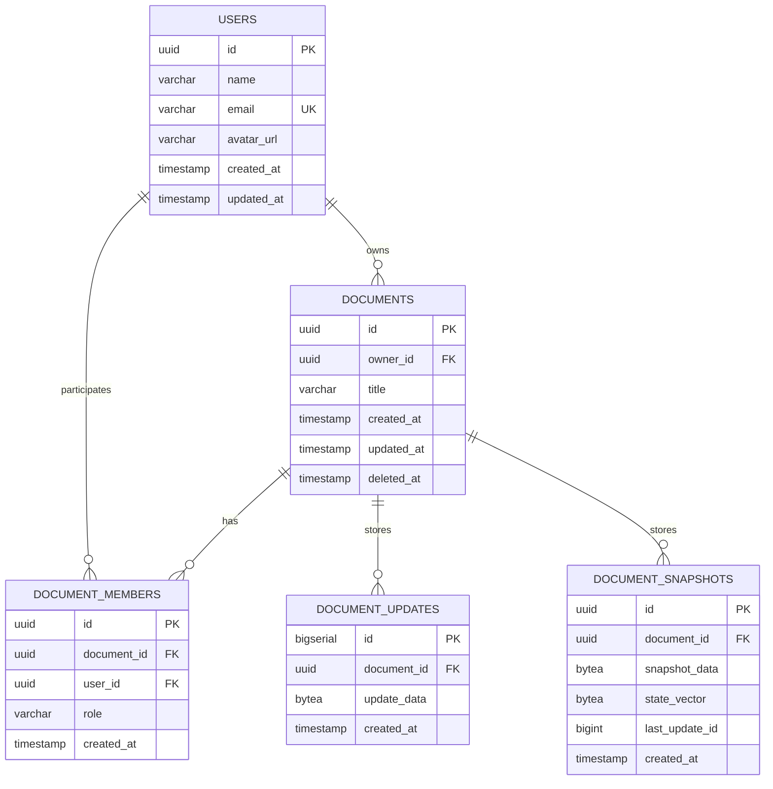

# DATABASE.md

# CollabNote — Database Design

**Version:** 1.0  
**Database:** Neon PostgreSQL  
**ORM:** Drizzle ORM (proposed)  
**Language:** TypeScript  
**Status:** Initial database specification

---

## 1. Database Overview

CollabNote uses Neon PostgreSQL to store application data and durable collaborative document data.

The database has two primary responsibilities:

### 1.1 Application Data

Stores structured information about:

- Users.
- Documents.
- Document ownership.
- Document collaborators.
- Permissions.
- Authentication-related records, if required by the chosen authentication strategy.

### 1.2 Collaborative Data

Stores:

- Encoded Yjs document updates.
- Periodic Yjs snapshots.
- Document persistence metadata.

**Important:** Collaborative document content must be persisted as Yjs-compatible data. A plain-text column is not the authoritative source for collaborative editing.

---

## 2. Database Technology

| Technology | Responsibility |
|---|---|
| Neon PostgreSQL | Hosted relational database |
| Drizzle ORM | Type-safe database queries and schema definitions |
| Drizzle Kit | Schema migrations |
| PostgreSQL `UUID` | Primary identifiers |
| PostgreSQL `BYTEA` | Encoded Yjs binary data |
| PostgreSQL timestamps | Record creation and modification times |

Use environment variables for database connection configuration.

Never expose the database connection string to the frontend.

---

## 3. Database Schema

The initial database contains five core tables:

1. `users`
2. `documents`
3. `document_members`
4. `document_updates`
5. `document_snapshots`

### 3.1 Entity Relationship Diagram



---

## 4. Table Specifications

### 4.1 Users

Stores application user information.

| Column | Type | Constraints |
|---|---|---|
| `id` | UUID | Primary key |
| `name` | VARCHAR(120) | Not null |
| `email` | VARCHAR(255) | Unique, not null |
| `avatar_url` | TEXT | Nullable |
| `created_at` | TIMESTAMPTZ | Not null |
| `updated_at` | TIMESTAMPTZ | Not null |

Requirements:

- Every user must have a unique email address.
- Email addresses should be normalized before storage.
- User identifiers must be UUIDs.
- Do not store plaintext passwords.

Authentication provider details and password storage belong to the authentication implementation. If email/password authentication is selected, store a secure password hash in an appropriate authentication table or extend the user schema deliberately.

### 4.2 Documents

Stores document metadata, not the authoritative collaborative content.

| Column | Type | Constraints |
|---|---|---|
| `id` | UUID | Primary key |
| `owner_id` | UUID | Foreign key to users |
| `title` | VARCHAR(255) | Not null |
| `created_at` | TIMESTAMPTZ | Not null |
| `updated_at` | TIMESTAMPTZ | Not null |
| `deleted_at` | TIMESTAMPTZ | Nullable |

Requirements:

- Every document has one owner.
- The owner must be an existing user.
- Documents should use UUID identifiers.
- Deletion should initially use soft deletion.
- Update `updated_at` when document metadata changes.
- Document content is stored through the Yjs persistence mechanism.

### 4.3 Document Members

Stores document collaborators and their permissions.

| Column | Type | Constraints |
|---|---|---|
| `id` | UUID | Primary key |
| `document_id` | UUID | Foreign key to documents |
| `user_id` | UUID | Foreign key to users |
| `role` | VARCHAR(20) | Not null |
| `created_at` | TIMESTAMPTZ | Not null |

Allowed roles:

- `editor`
- `viewer`

The document owner is represented by `documents.owner_id` and has full control.

Constraints:

- A user can only have one membership record per document.
- Add a unique constraint on `(document_id, user_id)`.
- Validate role values using a database constraint or equivalent schema validation.
- Membership changes must be authorized by the document owner.

### 4.4 Document Updates

Stores encoded Yjs updates.

| Column | Type | Constraints |
|---|---|---|
| `id` | BIGINT | Generated primary key |
| `document_id` | UUID | Foreign key to documents |
| `update_data` | BYTEA | Not null |
| `created_at` | TIMESTAMPTZ | Not null |

Purpose:

- Preserve collaborative document changes.
- Reconstruct document state.
- Recover document content after server restarts.
- Support synchronization with reconnecting clients.

Requirements:

- Store the binary Yjs update without converting it into plain text.
- Associate every update with a document.
- Use append-only behavior for update records.
- Avoid unsafe overwrites of previously persisted state.
- Apply appropriate retention and compaction policies as the system grows.

### 4.5 Document Snapshots

Stores periodic encoded Yjs document states.

| Column | Type | Constraints |
|---|---|---|
| `id` | UUID | Primary key |
| `document_id` | UUID | Foreign key to documents |
| `snapshot_data` | BYTEA | Not null |
| `state_vector` | BYTEA | Nullable |
| `last_update_id` | BIGINT | Nullable |
| `created_at` | TIMESTAMPTZ | Not null |

Purpose:

- Reduce the number of updates required during document recovery.
- Provide a known persisted document state.
- Support update-log compaction.

A snapshot should represent the Yjs state through a known update boundary.

Do not delete updates needed to recover from the latest valid snapshot until the replacement snapshot has been saved and verified.

---

## 5. Relationships and Constraints

The database must enforce the following relationships:

- One user can own many documents.
- One document has exactly one owner.
- One document can have many members.
- One user can collaborate on many documents.
- One document can have many persisted updates.
- One document can have many snapshots.

### Required constraints

1. `users.email` must be unique.
2. `documents.owner_id` must reference an existing user.
3. `document_members.document_id` must reference an existing document.
4. `document_members.user_id` must reference an existing user.
5. `(document_id, user_id)` must be unique.
6. `document_updates.document_id` must reference an existing document.
7. `document_snapshots.document_id` must reference an existing document.
8. Role values must be restricted to supported roles.

Use suitable foreign-key deletion behavior. Avoid cascading deletion of collaborative data without an explicit document deletion workflow.

---

## 6. Indexing Strategy

Add indexes for frequently used queries.

| Table | Index | Purpose |
|---|---|---|
| `users` | Unique index on `email` | User lookup |
| `documents` | `owner_id` | Owner's documents |
| `documents` | `updated_at` | Document ordering |
| `document_members` | `(document_id, user_id)` | Membership lookup |
| `document_members` | `user_id` | Documents shared with user |
| `document_updates` | `(document_id, id)` | Ordered update retrieval |
| `document_snapshots` | `(document_id, created_at)` | Latest snapshot lookup |

Avoid adding unnecessary indexes before measuring query performance.

---

## 7. Yjs Persistence Strategy

### 7.1 Selected Initial Approach

Use a hybrid persistence model:

- Append encoded Yjs updates to `document_updates`.
- Periodically store encoded document states in `document_snapshots`.
- Restore a document from its latest valid snapshot and subsequent updates.

### 7.2 Saving Updates

Conceptual workflow:

```text
User edits document
        |
        v
Yjs generates update
        |
        v
Hocuspocus receives update
        |
        v
Validate document access
        |
        v
Persist encoded update
        |
        v
Update becomes durable
```

The implementation must define how save failures are handled and how the server reports persistence status.

### 7.3 Loading Documents

```text
Client requests document
        |
        v
Authenticate user
        |
        v
Authorize document access
        |
        v
Load latest valid snapshot
        |
        v
Load updates after snapshot boundary
        |
        v
Reconstruct Y.Doc
        |
        v
Synchronize connected clients
```

Use Yjs APIs to apply the stored binary updates and restore the document.

### 7.4 Snapshot Compaction

A snapshot can reduce recovery time when the update history grows.

Conceptual process:

1. Load the current Y.Doc.
2. Encode its complete state.
3. Record the update boundary represented by the snapshot.
4. Save the snapshot.
5. Verify the snapshot was committed successfully.
6. Only then consider deleting updates covered by that snapshot.

Snapshot creation and update cleanup must be designed to avoid losing changes written during compaction.

---

## 8. Database Access Architecture

All database access must happen through the backend.

```text
Next.js Frontend
       |
       | HTTPS / WebSocket
       v
Express / Hocuspocus
       |
       v
Application Services
       |
       v
Database Repositories
       |
       v
Drizzle ORM
       |
       v
Neon PostgreSQL
```

Rules:

- Frontend code must never connect directly to Neon.
- API routes should not contain complex SQL or persistence logic.
- Database queries should be organized into repository or data-access modules.
- Validate data before database writes.
- Use transactions for operations that must succeed or fail together.
- Keep collaboration persistence separate from ordinary document metadata operations.

---

## 9. Suggested Database Folder Structure

```text
apps/server/src/database/
│
├── schema/
│   ├── users.schema.ts
│   ├── documents.schema.ts
│   ├── document-members.schema.ts
│   ├── document-updates.schema.ts
│   └── document-snapshots.schema.ts
│
├── repositories/
│   ├── users.repository.ts
│   ├── documents.repository.ts
│   ├── members.repository.ts
│   └── collaboration.repository.ts
│
├── migrations/
│
├── connection.ts
└── index.ts
```

Drizzle schema definitions should remain separate from business logic.

---

## 10. Environment Variables

Backend environment variables:

```env
DATABASE_URL=
```

The connection string must:

- Be stored in a local environment file during development.
- Be configured through deployment environment settings in production.
- Never be committed to Git.
- Never be exposed through a `NEXT_PUBLIC_` variable.

The exact Neon connection configuration must follow the selected runtime and deployment environment.

---

## 11. Migration Strategy

Use Drizzle Kit for schema migrations.

Expected workflow:

1. Define or modify Drizzle schema files.
2. Generate migration files.
3. Review the generated SQL.
4. Apply migrations to the development database.
5. Verify table definitions and constraints.
6. Test application queries.
7. Apply reviewed migrations to production.

Never make undocumented manual production schema changes.

Migration files should be committed to version control.

---

## 12. Data Integrity and Security

- Enforce ownership and membership relationships.
- Check permissions before reading or modifying documents.
- Do not rely on frontend access restrictions.
- Validate document identifiers.
- Protect database credentials.
- Use parameterized queries through Drizzle.
- Handle failed transactions.
- Avoid logging sensitive credentials or document content.
- Back up important database data.
- Test recovery from persisted Yjs state.

---

## 13. Database Acceptance Criteria

- [ ] Neon PostgreSQL connection works.
- [ ] Drizzle ORM is configured.
- [ ] All core tables are created through migrations.
- [ ] User email uniqueness is enforced.
- [ ] Documents reference valid owners.
- [ ] Document memberships enforce unique user/document pairs.
- [ ] Owner, editor, and viewer permissions are supported.
- [ ] Yjs updates are stored as binary data.
- [ ] Snapshots can be stored and retrieved.
- [ ] A Y.Doc can be reconstructed from persisted data.
- [ ] Updates written after a snapshot are recoverable.
- [ ] Persistence survives a backend restart.
- [ ] Database access is restricted to backend services.

---

## 14. Decisions to Confirm Before Implementation

The following decisions remain provisional:

1. **ORM:** Drizzle ORM is the proposed choice.
2. **Authentication:** Password-based authentication or an external authentication provider.
3. **Persistence:** Hybrid update-log and snapshot strategy.
4. **Snapshot frequency:** To be determined through testing.
5. **Document deletion:** Soft deletion initially; permanent deletion policy to be defined.
6. **Sharing:** Invitation and membership creation workflow to be finalized.

Do not silently change these decisions during implementation.

---

**End of DATABASE.md**
